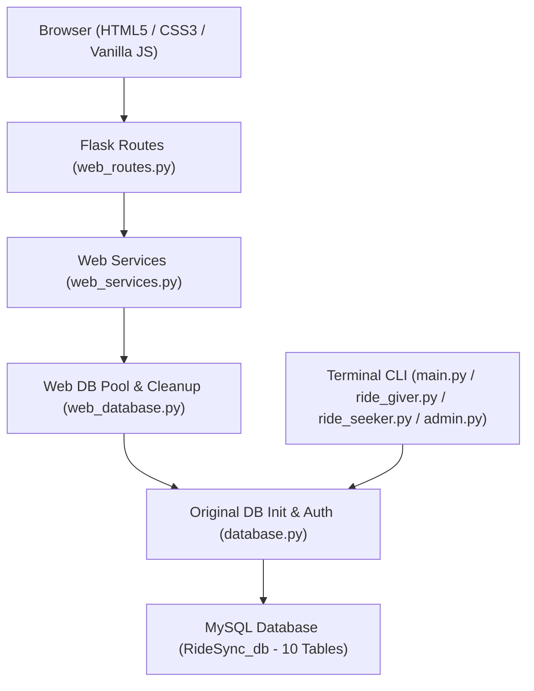
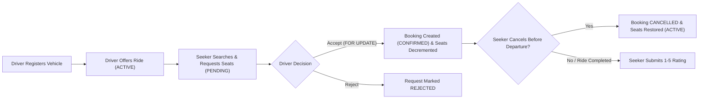

# RideSync – College Ride Sharing System

> **"Share Seats, Share Safety. Ride Together, Reach Together."**

RideSync is a college ride-sharing platform built with **Python**, **Flask**, and **MySQL** that connects students travelling along the same routes. It supports both a modern dark-themed web application and the original Python terminal application, sharing a single MySQL database (`RideSync_db`) and unified business rules.

---

## Table of Contents

1. [Overview](#overview)
2. [Problem Statement](#problem-statement)
3. [Objectives](#objectives)
4. [Key Features](#key-features)
5. [Ride Matching System](#ride-matching-system)
6. [Technology Stack](#technology-stack)
7. [Project Architecture](#project-architecture)
8. [Project Folder Structure](#project-folder-structure)
9. [Database Design](#database-design)
10. [Application Workflows](#application-workflows)
11. [Installation and Setup](#installation-and-setup)
12. [How to Run](#how-to-run)
13. [Security and Validation](#security-and-validation)
14. [Screenshots](#screenshots)
15. [Future Improvements](#future-improvements)
16. [Contributors](#contributors)
17. [Conclusion](#conclusion)
18. [Tags](#tags)

---

## Overview

RideSync is designed for college students commuting between home and campus. Students with registered vehicles (**Ride Givers**) can offer empty seats on upcoming trips, set a per-seat fare, and review incoming passenger requests. Students looking for a ride (**Ride Seekers**) can browse upcoming rides, search by route and preferred time, request seats, manage bookings, and rate drivers after completed trips.

An **Admin Portal** provides user, vehicle, report, feedback, active-ride, and audit-record oversight.

---

## Problem Statement

College students commuting daily often face:
- High individual travel costs when commuting alone by cab or personal vehicle.
- Difficulty coordinating shared rides with fellow students heading to the same destination at similar times.
- Lack of structured seat availability tracking, request approval, and transparent driver feedback in informal messaging groups.

---

## Objectives

- Provide a dedicated ride-sharing platform for college students using verified college/Gmail registration rules.
- Enable drivers to register vehicles, publish rides with clear per-seat pricing, and control seat approvals.
- Match seekers with eligible rides based on route, date, time proximity, seat availability, and driver ratings.
- Maintain accurate seat counts and booking records using atomic MySQL transactions and row locking.
- Preserve both the original terminal interface (`main.py`) and the Flask web interface (`web_app.py`) over the same `RideSync_db` database.

---

## Key Features

### Ride Giver
- **Vehicle Registration & Management:** Register vehicles with unique registration numbers and passenger seating capacities; deactivate (`INACTIVE`) vehicles while preserving past rides.
- **Ride Posting (`Offer a Ride`):** Post upcoming rides using active vehicles, existing active locations or newly created locations, future date/time, available passenger seats, and per-seat price.
- **Incoming Request Management:** View `PENDING` requests for active rides and **Accept** (creating a `CONFIRMED` booking and decrementing seats) or **Reject** them.
- **Ride Updates:** Update pickup/destination/date/time (when no confirmed bookings exist), adjust seat capacity (not below already booked seats), and update per-seat price.
- **Ride History & Received Feedback:** View all posted rides and passenger ratings/comments received.

### Ride Seeker
- **Find Rides:** Browse all upcoming `ACTIVE` rides from other drivers or search by pickup, destination, date, preferred time, and required seats.
- **Ride Details & Fare Preview:** View driver name, rating, vehicle info, route, available seats, and live estimated total fare before submitting a request.
- **Ride Requests:** Send seat requests (`PENDING`) with duplicate-request and price-change protection.
- **Bookings & Cancellation:** View confirmed, completed, and cancelled bookings; cancel eligible `CONFIRMED` bookings before departure to restore available seats.
- **Driver Details:** View driver contact information (`full_name`, `email`, `phone`) and vehicle details for booked rides.
- **Ride History & Feedback:** View full booking history and submit a 1–5 star rating and optional comment once per completed booking on a completed ride.

### Admin
- **Admin Registration & Login:** Protected by the server-side Admin Portal Access Password, numeric Admin ID, password, and 5-attempt lockout rules.
- **User Management:** View registered users and update account statuses (`ACTIVE`, `BLOCKED`, `INACTIVE`).
- **Vehicle Management:** View registered vehicles and update statuses (`ACTIVE`, `INACTIVE`).
- **Report Management:** Review reports and update statuses (`PENDING`, `UNDER_REVIEW`, `RESOLVED`, `REJECTED`) with admin remarks and resolution timestamps.
- **Feedback & Ongoing Ride Monitoring:** View all `Ratings_Feedback` entries and monitor currently `ACTIVE` rides.
- **Audit Logs:** View chronological administrative actions recorded in `Audit_Records`.

---

## Ride Matching System

When a Ride Seeker searches for rides in `search_matching_rides()` (mirroring `ride_seeker.py`), the system:

1. Filters `Rides` in MySQL where:
   - `pickup_location_id` and `destination_location_id` match (and are not identical).
   - `ride_date` matches the requested future date.
   - `available_seats >= required_seats`.
   - `ride_status = 'ACTIVE'` and `driver_id <> current_user_id`.
   - The ride departure is in the future (`ride_date > CURDATE()` or `ride_date = CURDATE() AND ride_time > CURTIME()`).
2. Evaluates time proximity within a **±30-minute window (`1800` seconds)** of the seeker's preferred time.
3. Computes a **weighted matching score out of 100**:
   - **Time Score (up to 60 points):** `((1800 - time_difference_seconds) / 1800) * 60`
   - **Driver Rating Score (up to 40 points):** `(average_rating / 5) * 40`
   - **Final Score:** `time_score + rating_score`
4. Sorts matching rides in descending order of `final_score`.

---

## Technology Stack

| Category | Technology | Role in RideSync |
|---|---|---|
| **Backend** | Python 3, Flask | Web server, routing, session management, CSRF protection, and service layer |
| **Database** | MySQL (`RideSync_db`) | Relational data storage across 10 normalized tables with foreign keys and `CHECK` constraints |
| **DB Connectivity** | `mysql-connector-python` | Parameterized SQL queries, connection pooling, and `FOR UPDATE` transactions |
| **Templating** | Jinja2 | Server-side HTML rendering with reusable `base.html` and component macros |
| **Frontend** | HTML5, CSS3, JavaScript | Dark navy/blue/cyan UI, responsive layout, native date pickers, and custom 24-hour analog clock picker |

---

## Project Architecture

RideSync separates the original terminal application from the Flask web integration layer while keeping all business logic consistent:

- **Terminal Application (`main.py`):** Interactive CLI menus calling `database.py`, `ride_giver.py`, `ride_seeker.py`, and `admin.py`.
- **Flask Web Layer (`web_app.py`, `web_routes.py`, `web_services.py`, `web_database.py`):** Adapts the exact same validations, SQL queries, and transaction sequences for HTTP requests without importing `main.py` (which overrides `builtins.print` for terminal typing effects).



---

## Project Folder Structure

```text
backend/
├── main.py                  # Original terminal entry point & user auth/menus
├── database.py              # MySQL connection, password prompt, & 10-table schema init
├── ride_giver.py            # Original terminal Ride Giver workflows
├── ride_seeker.py           # Original terminal Ride Seeker workflows
├── admin.py                 # Original terminal Admin Portal workflows
│
├── web_app.py               # Flask app factory, server-side session rotation, CSRF, startup
├── web_database.py          # MySQLConnectionPool & transaction-safe cursor context manager
├── web_services.py          # Web-compatible business logic mirroring original modules
├── web_routes.py            # Flask routes for Public, Auth, Seeker, Giver, and Admin
├── requirements.txt         # Python package dependencies
├── index_reference.html     # Home-page design reference
├── README.md                # Project documentation
│
├── static/
│   ├── css/
│   │   ├── style.css        # Centralized :root theme, glows, navbar, cards, tables, badges
│   │   ├── forms.css        # Form inputs, date picker styling, 24h analog clock styles
│   │   ├── dashboard.css    # Sidebar layout, stat cards, ride cards, fare summaries
│   │   └── responsive.css   # Desktop, tablet, and mobile breakpoints
│   └── js/
│       └── main.js          # Mobile nav, alerts, fare preview, location toggles, 24h analog clock
│
└── templates/
    ├── base.html            # Shared base layout
    ├── index.html           # Landing page
    ├── about.html           # About RideSync
    ├── safety.html          # Implemented safety controls overview
    ├── login.html           # Student login
    ├── register.html        # Student registration
    ├── dashboard.html       # User dashboard with live stats
    ├── profile.html         # User profile view
    ├── error.html           # 403 / 404 / 500 error page
    ├── components/
    │   ├── alerts.html
    │   ├── footer.html
    │   ├── navbar.html
    │   ├── sidebar.html
    │   └── status_badge.html
    ├── ride_seeker/
    │   ├── find_rides.html
    │   ├── ride_details.html
    │   ├── ride_requests.html
    │   ├── bookings.html
    │   ├── ride_history.html
    │   ├── driver_details.html
    │   └── feedback.html
    ├── ride_giver/
    │   ├── giver_dashboard.html
    │   ├── register_vehicle.html
    │   ├── my_vehicles.html
    │   ├── offer_ride.html
    │   ├── my_rides.html
    │   ├── manage_requests.html
    │   ├── update_ride.html
    │   ├── ride_history.html
    │   └── received_feedback.html
    └── admin/
        ├── admin_login.html
        ├── admin_register.html
        ├── admin_dashboard.html
        ├── users.html
        ├── vehicles.html
        ├── reports.html
        ├── feedback.html
        ├── ongoing_rides.html
        └── audit_logs.html
```

---

## Database Design

All 10 tables are defined and initialized in [database.py](file:///d:/Documents/backend/database.py) inside `RideSync_db`:

| # | Table | Purpose | Key Columns & Statuses / Constraints |
|---|---|---|---|
| 1 | `Users` | Student accounts | `user_id` (PK), `full_name`, `college_id` (UNIQUE), `email` (UNIQUE), `phone` (UNIQUE), `password`, `account_status` (`ACTIVE`, `BLOCKED`, `INACTIVE`), `failed_login_attempts`, `locked_until`, `created_at` |
| 2 | `Vehicles` | Registered vehicles | `vehicle_id` (PK), `owner_id` (FK → `Users`), `vehicle_name`, `registration_number` (UNIQUE), `seating_capacity` (`CHECK > 0`), `vehicle_status` (`ACTIVE`, `INACTIVE`), `created_at` |
| 3 | `Locations` | Pickup & drop points | `location_id` (PK), `city`, `region`, `area`, `point_name`, `is_active` (`BOOLEAN`) |
| 4 | `Rides` | Posted rides | `ride_id` (PK), `driver_id` (FK → `Users`), `vehicle_id` (FK → `Vehicles`), `pickup_location_id` & `destination_location_id` (FK → `Locations`, `CHECK <>`), `ride_date`, `ride_time`, `total_seats`, `available_seats`, `price_per_seat`, `ride_status` (`ACTIVE`, `FULL`, `COMPLETED`, `CANCELLED`) |
| 5 | `Ride_Requests` | Seeker seat requests | `request_id` (PK), `ride_id` (FK → `Rides`), `seeker_id` (FK → `Users`), `seats_requested` (`CHECK > 0`), `request_status` (`PENDING`, `ACCEPTED`, `REJECTED`, `CANCELLED`, `EXPIRED`), `requested_at`, `responded_at` |
| 6 | `Bookings` | Confirmed/past bookings | `booking_id` (PK), `request_id` (UNIQUE FK → `Ride_Requests`), `ride_id` (FK → `Rides`), `seeker_id` (FK → `Users`), `seats_booked` (`CHECK > 0`), `booking_status` (`CONFIRMED`, `CANCELLED`, `COMPLETED`), `booked_at`, `cancelled_at` |
| 7 | `Ratings_Feedback` | Driver ratings & reviews | `feedback_id` (PK), `booking_id` (UNIQUE FK → `Bookings`), `ride_id` (FK → `Rides`), `driver_id` & `seeker_id` (FK → `Users`), `rating` (`CHECK 1..5`), `comment`, `created_at` |
| 8 | `Reports` | Complaints / reports | `report_id` (PK), `reported_by` & `related_user_id` (FK → `Users`), `ride_id` (FK → `Rides`), `description`, `report_status` (`PENDING`, `UNDER_REVIEW`, `RESOLVED`, `REJECTED`), `admin_action`, `created_at`, `resolved_at` |
| 9 | `Audit_Records` | Admin audit trail | `audit_id` (PK), `user_id` (FK → `Users`, `NULL` for admin actions), `action`, `details`, `created_at` |
| 10 | `Admin` | Administrator accounts | `admin_id` (PK), `full_name`, `email` (UNIQUE), `phone` (UNIQUE, `NOT NULL`), `password`, `admin_status` (`ACTIVE`, `BLOCKED`, `INACTIVE`), `failed_login_attempts`, `locked_until`, `created_at` |

---

## Application Workflows

### 1. Ride Booking & Seat Management Lifecycle



### 2. Core Workflows Summary
- **Student Registration & Login:** Validates alphabets-only full name, `college_id` (1–30 chars), `@gmail.com` or `@bennett.edu.in` email (alphanumeric username ≥ 8 chars), 10-digit phone, and ≥ 8-char ASCII alphanumeric password with ≥ 1 letter. Login enforces `ACTIVE` status and locks accounts for 15 minutes after 5 failed attempts.
- **Vehicle Registration & Ride Posting:** Drivers register a unique vehicle (`registration_number`) and post future rides with `1 <= seats <= seating_capacity`, distinct pickup/destination, and positive `price_per_seat`.
- **Request Acceptance / Rejection:** Uses `SELECT ... FOR UPDATE` on `Ride_Requests` and `Rides` to prevent overbooking; accepting inserts a `CONFIRMED` row in `Bookings`, marks the request `ACCEPTED`, and flips `ride_status` to `FULL` if `available_seats` reaches `0`.
- **Booking Cancellation:** Uses `FOR UPDATE` on `Bookings` and `Rides`; cancels `CONFIRMED` bookings on upcoming non-completed/non-cancelled rides and restores `available_seats`.
- **Admin Operations:** Validates the server-side portal access password and numeric `Admin ID` (5-minute lockout after 5 failed attempts), manages user/vehicle/report statuses, monitors active rides/feedback, and logs actions to `Audit_Records`.

---

## Installation and Setup

### Prerequisites
- **Python 3.10+** (tested with Python 3.14.7)
- **MySQL Server** running on `localhost`
- **VS Code** or any Python IDE

### Installation
1. Open the project folder (`backend/`) in VS Code.
2. Install dependencies from `requirements.txt`:
   ```bash
   python -m pip install -r requirements.txt
   ```
3. Ensure your local MySQL server is running on `localhost` with `root` user access. On startup, `database.py` automatically creates `RideSync_db` and all 10 tables if they do not already exist.

---

## How to Run

### Web Application (Flask)
```bash
python web_app.py
```
1. Enter your local MySQL `root` password once when prompted in the terminal.
2. Open your browser and navigate to:
   ```text
   http://127.0.0.1:5000
   ```
*(The Flask debug reloader is intentionally disabled so the terminal MySQL password prompt executes only once.)*

### Original Terminal Application
```bash
python main.py
```
1. Enter your local MySQL `root` password when prompted.
2. Use the interactive numbered terminal menus for the User Portal and Admin Portal.

---

## Security and Validation

### Implemented Controls
- **Server-Side Sessions & Session Rotation:** `InMemoryServerSessionInterface` in `web_app.py` generates a `32`-byte URL-safe session ID and rotates it (`rotate_user_session`) on login and logout to prevent session fixation.
- **Secure Cookie Flags:** `HttpOnly=True`, `SameSite=Lax`, and configurable `Secure` flag (`RIDESYNC_HTTPS=1`).
- **CSRF Protection:** Every `POST` form includes a per-session `csrf_token` validated on the server before request handling (`403` on mismatch/missing).
- **Role Separation & Ownership Checks:** `@user_login_required` and `@admin_login_required` isolate user and admin sessions; database queries verify `owner_id`, `driver_id`, or `seeker_id` ownership.
- **SQL Injection Prevention:** All queries use `%s` parameterized statements via `mysql-connector-python`.
- **Transaction Safety:** Multi-step operations use explicit `start_transaction()`, `FOR UPDATE` row locks, `commit()`, and `rollback()` with guaranteed cursor/connection cleanup.
- **Brute-Force Lockout:** 5 failed login attempts trigger a 15-minute lockout for users and a 5-minute lockout for admins.

### Known Limitations
- **Plaintext Password Comparison:** `Users.password`, `Admin.password`, and `PORTAL_ACCESS_PASSWORD` are stored/compared in plaintext to preserve compatibility with the original terminal application (`main.py` and `admin.py`).
- **In-Memory Session Store:** Active web sessions are stored in Flask process memory and reset if the server restarts.
- **Development Server:** `web_app.py` runs Flask's built-in HTTP server (`127.0.0.1:5000`) and is **not** configured for direct public production deployment without HTTPS, hashed passwords, and a production WSGI server.

---

## Screenshots

> Replace the placeholders below with actual screenshots captured from your running local instance (`http://127.0.0.1:5000`):

| Page | Placeholder |
|---|---|
| **Homepage** | `[Screenshot Placeholder: Home Page — Hero & Animated Home-to-Campus Route]` |
| **Login & Registration** | `[Screenshot Placeholder: Student Login & Registration Pages]` |
| **Ride Seeker Dashboard & Search** | `[Screenshot Placeholder: Find Rides with Calendar & 24h Analog Clock Picker]` |
| **Ride Giver Dashboard & Offer Ride** | `[Screenshot Placeholder: Offer Ride & Manage Incoming Requests]` |
| **Admin Dashboard** | `[Screenshot Placeholder: Admin Panel — Users, Vehicles, Reports & Audit Logs]` |

---

## Future Improvements

*(Not currently implemented in the codebase)*
- Password hashing (e.g., `werkzeug.security` / `bcrypt`) across both CLI and web portals.
- Persistent session storage (e.g., Redis or database-backed sessions) and HTTPS production WSGI deployment.
- User-facing report submission form connected to the existing `Reports` table.
- Automated email or in-app notifications for ride request approvals and cancellations.

---

## Contributors

- `[Contributor Name / GitHub Handle]` — Project Author & Backend Developer
- `[Team Member Name]` — Contributor *(edit as needed)*

---

## Conclusion

RideSync demonstrates how a structured relational MySQL backend can power both a terminal application and a responsive, theme-consistent Flask web platform for college carpooling. By preserving atomic seat management, transparent ratings, and role-based administration, RideSync makes campus commuting more affordable and coordinated.

---

## Tags

`python` `flask` `mysql` `mysql-connector-python` `jinja2` `html5` `css3` `javascript` `ridesync` `carpooling` `college-project` `ride-sharing`
